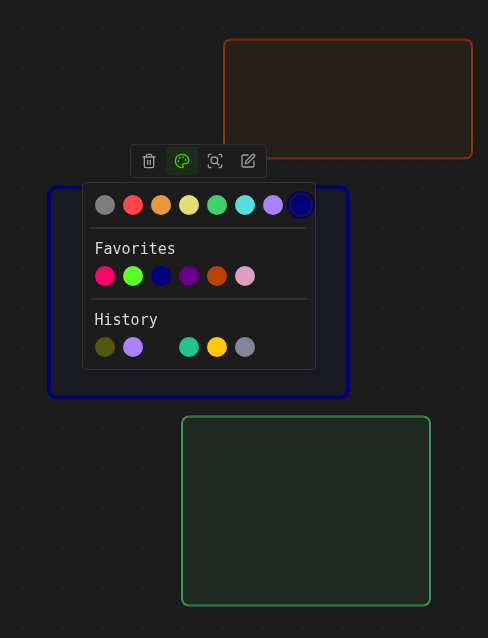
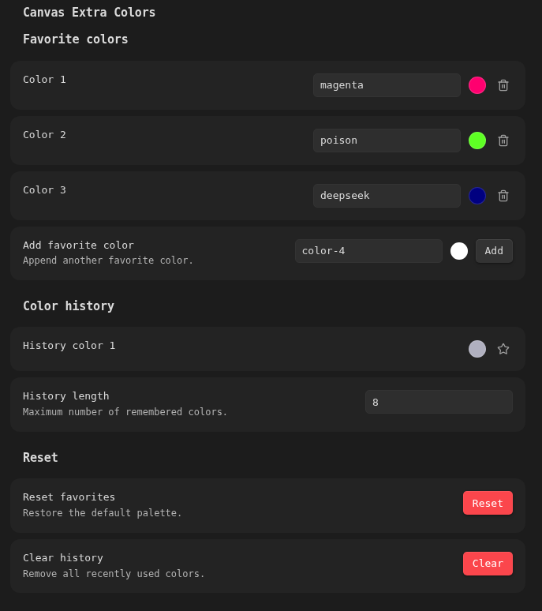

## Canvas Extra Colors
plugin that allows you to store and access custom colors in canvas.

### Favourites
In the settings you can define and name custom colors using the color picker.
These colors then show up in the canvas editor under the the color selector menu.

### History
When you select custom colors using the color palette in the color selector menu,
they are stored in the color history. 
In the settings you can 'pin' colors from your history to add them to your favourites list.

 

